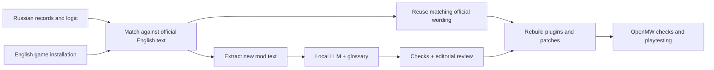

# Chaos Heart: Russian → English localisation

**A working game-localisation pipeline, a faction-specific editorial voice, and the debugging needed to keep dialogue playable.**

An independent project developed with AI coding and translation assistance. The goal was to play Russian 1C Morrowind with Chaos Heart in English while retaining the Russian release's game logic and the mod's behaviour.

This repository documents the engineering and editorial work. It is a portfolio case study, not a downloadable modpack. It contains no game masters, game assets, original dialogue corpus or third-party mod files.

[Русское описание](README.ru.md) · [Faction voice](FACTION-VOICE.md) · [Engineering](ENGINEERING.md) · [Status and lessons](STATUS.md)

## Why this was more than translating strings

Chaos Heart changes Morrowind's quests and systems. Replacing Russian masters with English ones would lose the behaviour the project was intended to preserve. Translating every Russian string afresh would also discard Bethesda's established English wording and introduce avoidable terminology drift.

The solution was to separate **game logic**, **official localisation** and **new mod writing**:

1. Keep the Russian record structure, scripts and fixes.
2. Match records to an English GOG installation and reuse official English text where appropriate.
3. Extract the remaining Chaos Heart strings, with record and dialogue context.
4. Translate new material using local inference, glossaries and AI-assisted editorial passes.
5. Validate topic phrases, variables, encoding and terminology.
6. Rebuild plugins and dependent patches, then test in OpenMW.

## My contribution and the AI's contribution

I defined the localisation goals, selected the faction's voice references, set lore and terminology rules, assessed model quality, and directed review and in-game iteration. Claude Code assisted with Python tooling, translation, editorial rewrites and debugging. A local Gemma model produced bulk translation drafts through ollama. This was an AI-assisted workflow, not a claim that every script or line was written unaided.

A later preference for testing Qwen was recorded after dissatisfaction with Gemma's quality. The completed bulk translation should not be attributed to Qwen or Codex.

## Selected results

The project handoff records:

| Work | Recorded scope |
|---|---:|
| Extracted translation workload | Approximately 26,000 strings |
| Camonna Tong style pass | 618 keyed entries |
| Books completed in the Claude-assisted pass | 341 |
| First systematic dialogue sample | 1,615 reviewed; 705 corrected |
| Second sample | 1,646 reviewed; 688 corrected |
| Remaining-dialogue review | 14,638 reviewed; 9,096 corrected |

These are workflow counts, not a controlled translation-quality benchmark. The passes had different scopes; the figures should not be summed into an invented accuracy score.

A particularly useful later fix concerned a Camonna Tong quest: a fluent paraphrase omitted the exact English topic phrase, preventing dialogue progression. Restoring the phrase repaired the link. The handoff records successful script and dialogue compilation checks after that fix.

## The distinctive editorial problem

Camonna Tong needed to sound like a coherent criminal organisation, rather than a collection of literal translations. The brief combined Baltimore crime-drama dialogue, Birmingham gang dialogue, and the roughness of *Kingdom Come: Deliverance* bandits, while preserving Morrowind's world and quest meaning.

The result was an **authored faction register**, not a phonetic accent filter or a claim of dialect authenticity. See [the voice brief and constraints](FACTION-VOICE.md).

## What this demonstrates

- Linux service operation, GPU resource constraints and resumable batch processing.
- Python-based extraction, matching, validation and rebuilding of structured data.
- Terminology management and consistency across a large text corpus.
- Troubleshooting failures at the boundary between prose and game mechanics.
- Giving AI systems constrained tasks, checking their output, and recognising when review cost outweighs inference speed.

## Current state

A playable English build and later fixes are documented. A consolidated, distributable release is still parked. The final packaging plan changed during development, and public distribution has unresolved permission and dependency requirements. See [the dated status](STATUS.md) rather than treating this as a finished public release.

## Credits and acknowledgements

Thanks to **Larkin, Lacm+, AikidoPanda, iGriver, and the original Chaos Heart developers and contributors**. See [CREDITS.md](CREDITS.md) for the versioned roster, Fullrest/TESAll threads, community links and historical websites. The original mod belongs to its creators; this is a separate localisation effort.
